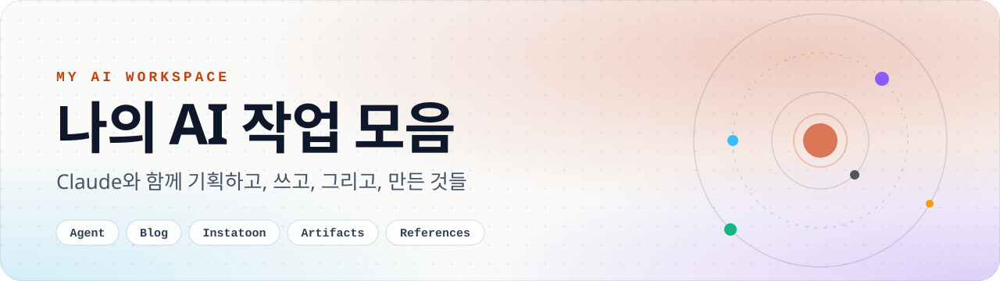
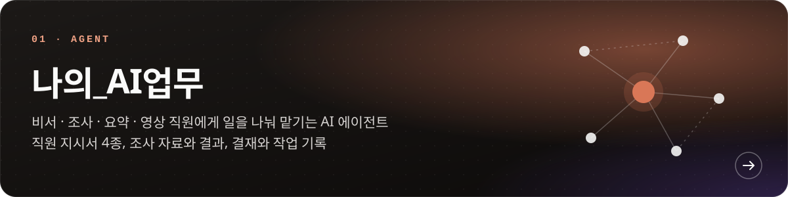
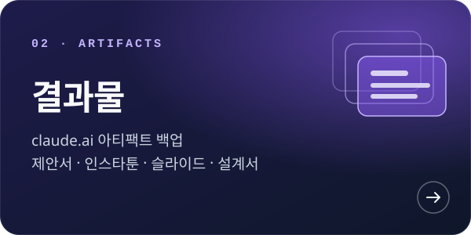
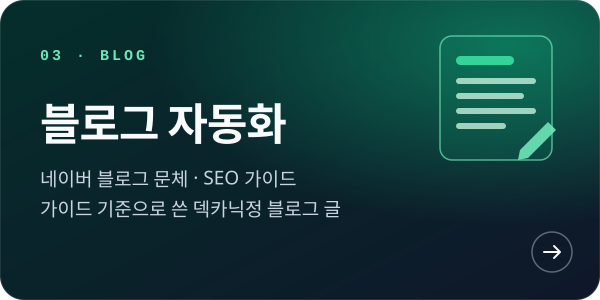
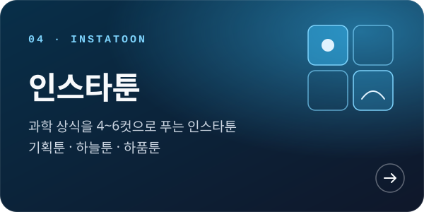
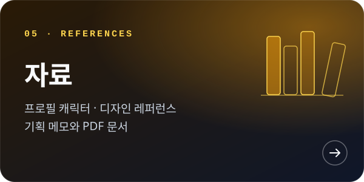
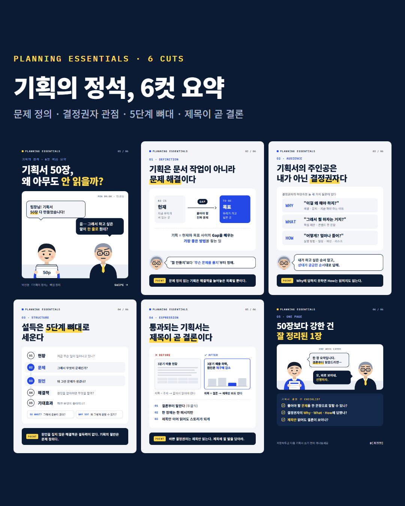
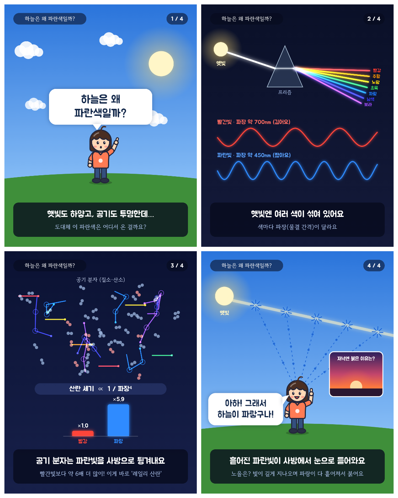
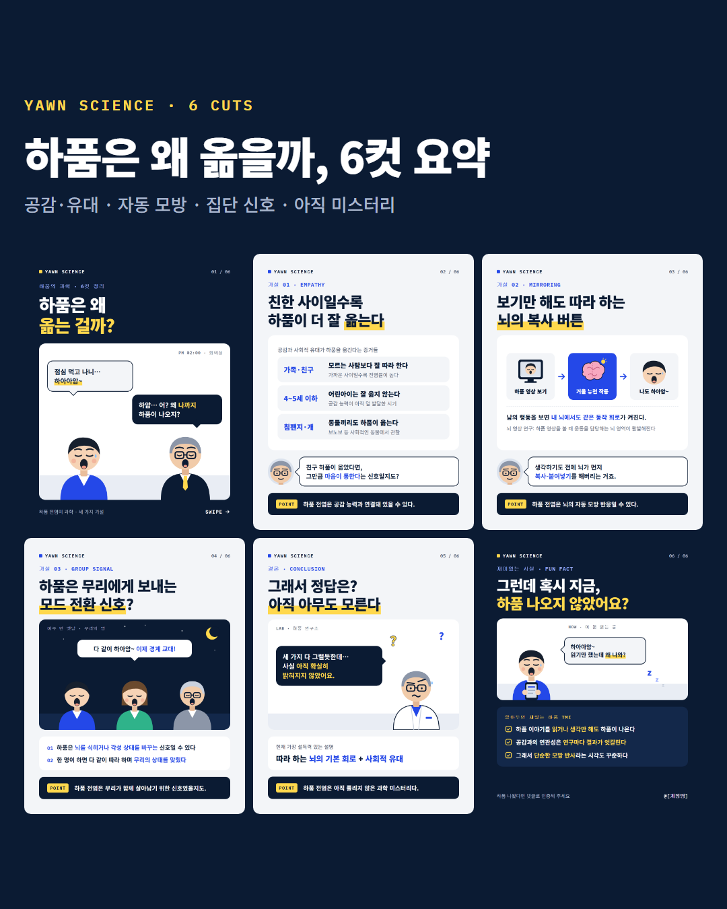

<picture>
  <source media="(prefers-color-scheme: dark)" srcset=".github/readme/banner-dark.svg" />
  
</picture>

<div align="center">

<br />


<br />

**[폴더](#폴더)** &nbsp;/&nbsp; **[작업 미리보기](#작업-미리보기)** &nbsp;/&nbsp; **[구조](#구조)** &nbsp;/&nbsp; **[아카데미 안내](#llm-academy-대전-1기)**

</div>

<br />

L.L.M Academy 대전 1기에서 Claude와 Claude Code로 진행한 개인 프로젝트 작업물을 모은 저장소입니다.

## 폴더

카드를 누르면 그 폴더로 이동합니다.

<p align="center">
  <a href="나의_AI업무"></a>
</p>
<p align="center">
  <a href="결과물"></a>&nbsp;<a href="블로그%20자동화"></a>
</p>
<p align="center">
  <a href="인스타툰"></a>&nbsp;<a href="자료"></a>
</p>

<br />

## 작업 미리보기

### 인스타툰

과학 상식 질문 하나를 4~6컷으로 풉니다. 컷별 이미지와 한눈에보기 이미지가 함께 있습니다.

<p align="center">
  <a href="인스타툰/기획툰_한눈에보기.png"></a>
  <a href="인스타툰/하늘툰_한눈에보기.png"></a>
  <a href="인스타툰/하품툰_한눈에보기.png"></a>
</p>
<p align="center"><sub>기획툰 &nbsp;·&nbsp; 하늘툰 &nbsp;·&nbsp; 하품툰</sub></p>

### 블로그 자동화

`style-guide.md`와 `SEO-guide.md`로 글쓰기 기준을 먼저 정하고, 그 기준으로 덱카닉정 블로그 글과 정보 카드를 만들었습니다.

<p align="center">
  
  
</p>

### 나의_AI업무

AI 직원에게 일을 나눠 맡기고, 결재와 작업 기록을 남기는 에이전트 설정입니다.

`비서` `조사직원` `요약직원` `영상직원` &nbsp;|&nbsp; `01_직원` `02_자료` `03_결과` `04_기록`

### 결과물

claude.ai 아티팩트를 아티팩트마다 폴더 하나씩 보관합니다. 목록은 [결과물/README.md](결과물/README.md)에 있습니다.

`감수 라인 제안서` `구매 제안` `한울호 슬라이드` `기획의 정석 6컷툰` `하늘은 왜 파란색일까` `에이전트 설계서` `프롬프트 세트`

<br />

## 구조

```text
daejeon_01
├── 나의_AI업무/      AI 에이전트 · 01_직원 · 02_자료 · 03_결과 · 04_기록
├── 결과물/           claude.ai 아티팩트 백업 · 아티팩트마다 폴더 1개
├── 블로그 자동화/    가이드 2종 · 블로그 글 · dexcanic-images/
├── 인스타툰/         컷별 이미지 · 한눈에보기 이미지
└── 자료/             프로필 캐릭터 · 레퍼런스 · PDF
```

<br />

## L.L.M Academy 대전 1기

이 저장소는 L.L.M Academy 대전 1기 수강생들의 프로젝트 수행을 위한 저장소를 Fork한 개인 저장소입니다.

<details>
<summary><b>이용 방법</b></summary>
<br />

1. 본 Repository 우측 상단의 `Fork` 버튼을 클릭합니다.
2. 본인의 GitHub 계정을 Owner로 선택하여 Fork를 생성합니다.
3. Fork한 개인 Repository에서 프로젝트를 진행합니다.
4. 개인 및 팀별 폴더 구성은 자유롭게 진행합니다.

</details>

<details>
<summary><b>팀 프로젝트</b></summary>
<br />

- 팀 프로젝트는 팀원 간 협의하여 공동 작업 공간을 구성합니다.
- 필요한 경우 팀원을 Collaborator로 초대하여 함께 작업할 수 있습니다.

</details>

> **유의사항**
>
> - 본 Repository 및 Fork한 Repository는 Public으로 외부에 공개됩니다.
> - 개인정보, 비밀번호, API Key 등 민감한 정보는 업로드하지 마세요.
> - 프로젝트별 제출 및 평가 방식은 담당 강사의 안내를 따릅니다.

<br />

<div align="center">
<sub>Made with Claude &nbsp;·&nbsp; L.L.M Academy 대전 1기</sub>
</div>
