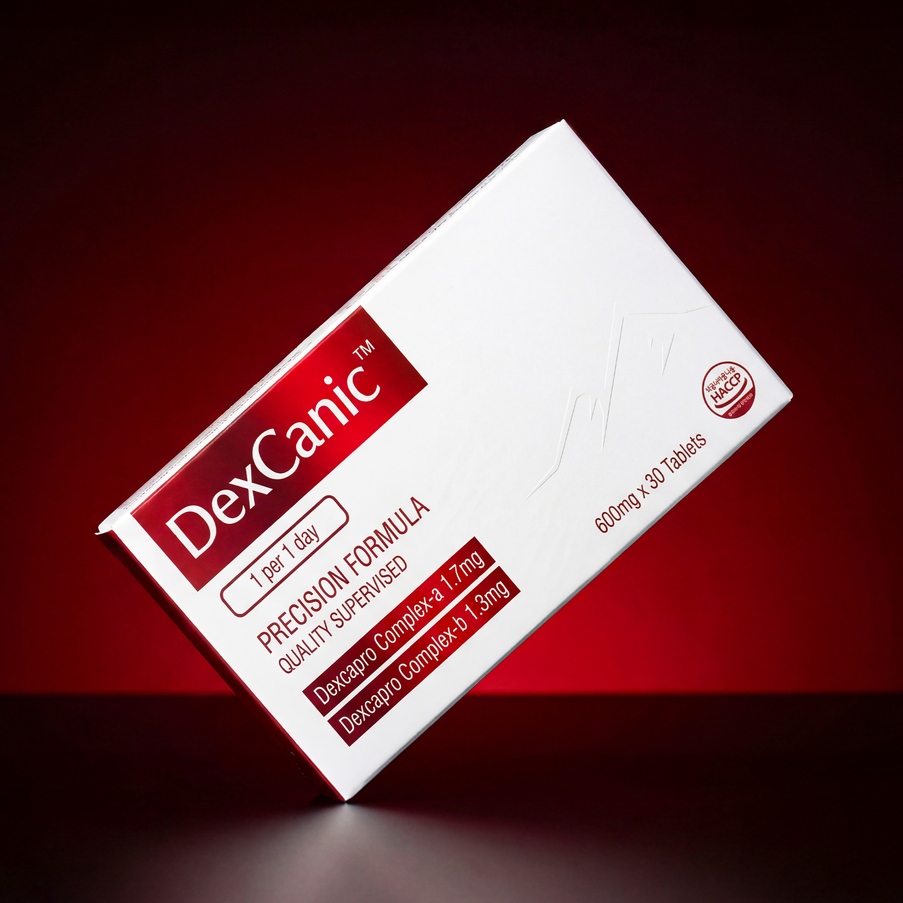
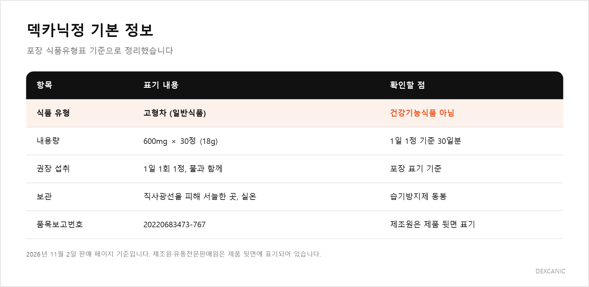
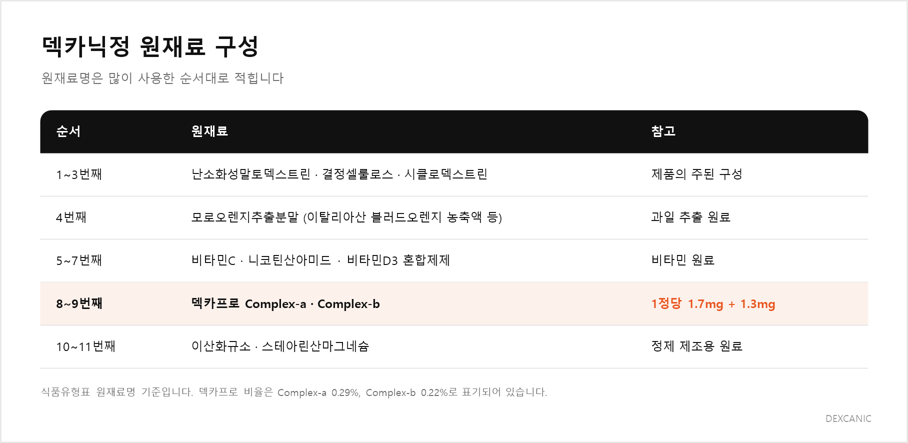
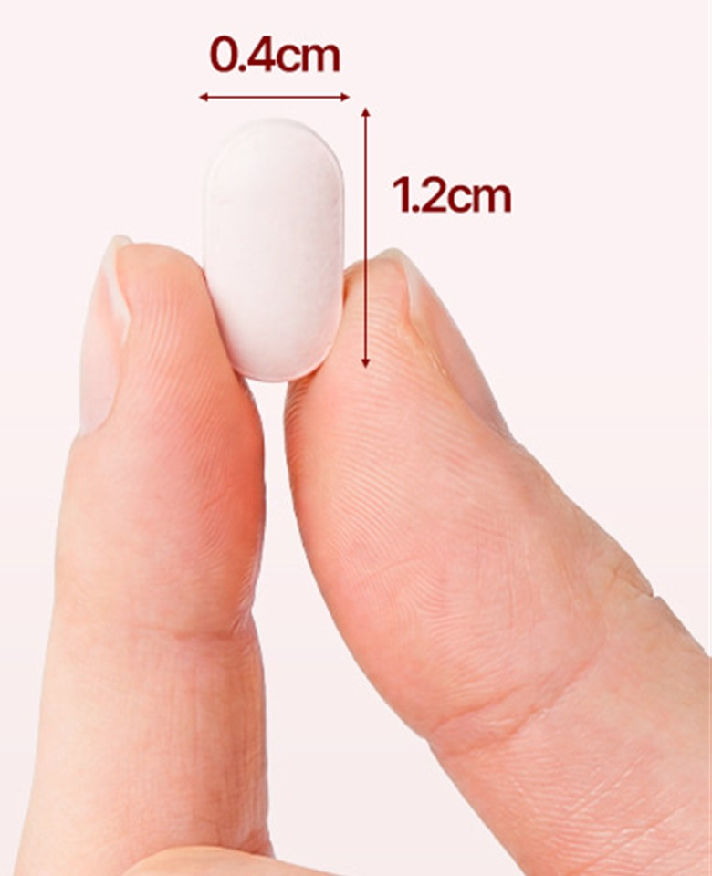
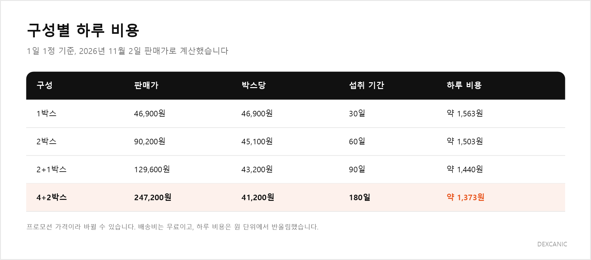

# [발행 메모] 덱카닉정 홍보 블로그 글

> 이 메모는 발행 전 확인용입니다. 네이버 블로그에는 아래 "본문 시작"부터 옮기세요.
> 작성 기준: `style-guide.md`(문체) + `SEO-guide.md`(네이버 SEO). 정보 출처: https://dexcanic.kr/product/list.html?cate_no=28 (2026-11-02 확인)

## 발행 정보
- **제목**: 덱카닉정이란? 성분표·섭취법·가격을 구매 전에 확인하는 법 (공백 포함 32자)
- **핵심 키워드**: 덱카닉정 / 세부: 덱카닉정 성분, 덱카닉정 섭취법, 덱카닉정 가격, 덱카프로 / 유의어: 덱카닉, 고형차
- **태그(8개)**: #덱카닉정 #덱카닉 #덱카프로 #덱카닉정성분 #덱카닉정섭취법 #덱카닉정가격 #고형차 #DexCanic
- **대표 이미지**: 1장 끝의 `photo1-dexcanic-box.jpg`를 에디터에서 대표 이미지로 지정 (정사각형 2000×2000, 제품이 가운데, 글자 없음)
- **AI 활용 표시(권장)**: 글 맨 끝에 "이 글은 AI 도구로 초안을 작성하고 담당자가 검수했습니다." 한 줄 추가 권장 (SEO-guide 8-3)

## 이미지 배치
| 위치 | 파일 | 상태 |
|---|---|---|
| 1장 끝 | `dexcanic-images/blog/photo1-dexcanic-box.jpg` | 브랜드 상세페이지 이미지 그대로 사용. **대표 이미지** |
| 2장 끝 | `dexcanic-images/blog/card1-dexcanic-basic-info.png` | 직접 제작 |
| 3장 끝 | `dexcanic-images/blog/card2-dexcanic-ingredients.png` | 직접 제작 |
| 4장 | `dexcanic-images/blog/photo2-dexcanic-tablet-size.jpg` | 브랜드 이미지에서 정제 부분만 잘라 냄 |
| 5장 끝 | `dexcanic-images/blog/card3-dexcanic-price-per-day.png` | 직접 제작 |

실물 사진은 이번 버전에 넣지 않았습니다. 나중에 찍게 되면 포장 뒷면 원재료명(3장), 손 위 정제(4장 `photo2` 교체)부터 추가하는 것을 권합니다.

## 발행 전 확인 필요
1. **게시 채널과 광고 표시**: 지금은 "덱카닉 공식 블로그" 기준으로 썼습니다. 브랜드와 대가 관계가 있는 다른 블로그에 올린다면 첫 줄을 `[광고] 이 글은 덱카닉으로부터 ○○을 제공받아 작성했습니다.`로 바꾸고, 본문보다 크게 또는 다른 색으로 표시하세요 (공정위 지침).
2. **직접 섭취 경험**: 이번 버전에는 넣지 않았습니다. 나중에 실제로 먹어 본 경험이 생기면 4장 '크기' 사진 다음에 섭취 기간·시간·크기 체감·맛을 3~5줄로 더하세요. 네이버가 높게 보는 경험 정보가 채워집니다. 효과 표현은 넣지 않습니다.
3. **환불 조건의 "2세트"**: 2박스를 뜻하는지 판매처에 확인하세요.
4. **가격**: 발행일 기준 판매가를 다시 확인하세요 (프로모션 가격이라 바뀔 수 있음).
5. **브랜드 이미지 사용 권한**: `photo1`, `photo2`는 브랜드 상세페이지 이미지입니다. 사용 허락을 확인하세요.

## 일부러 뺀 내용과 이유
덱카닉정의 식품유형은 **고형차(일반식품)**입니다. 「식품 등의 표시·광고에 관한 법률」 제8조는 일반식품을 건강기능식품처럼 보이게 하거나, 질병 예방·치료 효과가 있는 것처럼 알리거나, 거짓·과장·기만하는 광고를 금지합니다. 그래서 아래 내용은 본문에 넣지 않았습니다.
- 체중계 이미지, "가벼움", "다이어트 시장", 식욕 셀프 체크 같은 **다이어트·식욕 조절 암시**
- "흡수율과 효과 극대화", "대사 밸런스" 같은 **기능 표현**
- "스위스 수출가·판매가", "약국 입점 중단", "모델들의 선택" 후기, "국내 유일 최상위", "맘카페 입소문·10차 물량·품절 예고" 같은 **확인할 수 없는 주장**
- "87.2% 정제 탄수화물" 같은 **출처와 맞지 않는 통계**

## 네이버 에디터로 옮길 때
- `##` 소제목 → 에디터 '소제목' 서식 / `###` → '본문 굵게, 한 단계 큰 글씨'
- `==형광펜==` → 글자 배경색(노랑) + 굵게
- `>` 인용 블록 → 에디터 '인용구'
- 문단 안 줄바꿈은 한 줄씩 그대로 유지 (Shift+Enter)
- 이미지 캡션은 사진 설명란에 입력

---
---

# 본문 시작

# 덱카닉정이란? 성분표·섭취법·가격을 구매 전에 확인하는 법

> 덱카닉 공식 블로그에서 작성한 제품 안내 글입니다.

**이 글의 순서**
1. 덱카닉정이란? 하루 한 알 먹는 고형차입니다
2. 왜 식품유형부터 볼까요? 설명을 읽는 기준이 달라지기 때문입니다
3. 성분표로 보는 구성: 원재료는 많이 쓴 순서로 적힙니다
4. 덱카닉정 섭취법: 하루 1회 1정, 물과 함께
5. 가격은 박스가 아니라 하루 비용으로 보겠습니다
6. 결제 전에 확인할 것: 환불 조건과 판매처
7. 이런 분께 맞고, 이런 분은 먼저 상의하세요
8. 자주 받는 질문

매일 챙겨 먹을 식품을 고를 때는 비교할 것이 많습니다.  
제품마다 내세우는 문구가 다르고,  
상세페이지는 한참을 내려야 끝이 보입니다.  
**그런데 다 읽고 나도, 무엇이 얼마나 들어 있는지는 잘 남지 않습니다.**

덱카닉정을 처음 알아볼 때 궁금한 것도 결국 몇 가지로 모입니다.  
“하루에 몇 알 먹나요?”  
“한 달이면 얼마인가요?”

**1. 상세페이지 첫 화면 문구만 보고 고른다**  
**2. 성분표의 원재료 순서를 읽어 본 적이 없다**  
**3. 박스 가격만 보고 하루 비용은 계산하지 않는다**

하나라도 해당된다면, 아직 광고 문구로 제품을 고르고 계신 겁니다.  
==좋은 선택은 큰 글씨가 아니라,  
식품유형·성분표·하루 비용을 확인하는 데서 시작합니다.==  
오늘은 덱카닉정을 이 세 가지 기준으로 차근차근 풀어 보겠습니다.

## 덱카닉정이란? 하루 한 알 먹는 고형차입니다

덱카닉정은 600mg 정제 30정이 한 통에 든 제품입니다.  
식품유형은 고형차로 표기되어 있고,  
하루 1회 1정을 물과 함께 먹도록 안내합니다.  
**한 통이면 1일 1정 기준으로 딱 30일분입니다.**

이름 옆에 붙은 ‘덱카프로’는 브랜드가 만든 복합 원료의 이름입니다.  
포장에는 한 정에 Complex-a 1.7mg, Complex-b 1.3mg,  
합쳐서 3.0mg이 들어 있다고 적혀 있습니다.  
두 원료가 각각 무엇으로 이루어졌는지는 성분표 장에서 풀어 보겠습니다.

브랜드 콘셉트는 ‘스위스에서 영감을 받은 배합’입니다.  
제품 정보는 국내 기준에 맞춰 표기되어 있습니다.  
품목보고번호는 20220683473-767이고,  
포장에는 HACCP 인증 마크가 인쇄되어 있습니다.  
**콘셉트는 브랜드의 이야기이고,  
포장 표기는 누구나 확인할 수 있는 사실입니다.**

  
*1박스에는 600mg 정제 30정이 들어 있습니다.*

## 왜 식품유형부터 볼까요? 설명을 읽는 기준이 달라지기 때문입니다

식품유형은 그 제품이 어떤 식품으로 분류되는지 보여 주는 칸입니다.  
겉모양이 똑같은 정제라도  
건강기능식품인지, 일반식품인지에 따라  
제품을 설명하는 방식이 달라집니다.

건강기능식품은 식품의약품안전처가 기능성을 인정한 원료로 만들고,  
그 기능성을 정해진 문구로 표시하는 식품입니다.  
덱카닉정의 식품유형표에는 **고형차**라고 적혀 있습니다.  
**건강기능식품이 아니라, 차 종류에 속하는 일반식품인 겁니다.**

여기서 오해하기 쉬운 부분이 있습니다.  
정제 모양이라 영양제처럼 보이지만,  
분류상으로는 매일 마시는 차와 같은 갈래에 있습니다.  
그래서 저희는 이 제품을 소개할 때  
‘무엇이 달라진다’보다  
‘무엇이 들어 있고 어떻게 먹는지’를 먼저 말씀드리는 편입니다.

==식품유형은 구석의 작은 글씨가 아니라,  
제품 설명을 어떤 기준으로 읽을지 알려 주는 첫 번째 칸입니다.==

  
*식품유형과 권장 섭취량은 상세페이지 문구보다 포장 표기를 먼저 확인합니다.*

## 성분표로 보는 구성: 원재료는 많이 쓴 순서로 적힙니다

식품의 원재료명은 많이 사용한 순서대로 적습니다.  
그래서 성분표는 맨 앞 몇 줄만 읽어도  
제품의 뼈대가 무엇인지 보입니다.  
식품유형표의 원재료명을 순서대로 따라가 보겠습니다.

### 1~3번째: 난소화성말토덱스트린·결정셀룰로스·시클로덱스트린

원재료명의 첫 자리는 **난소화성말토덱스트린**입니다.  
전분에서 얻는 수용성 식이섬유 원료입니다.  
그 뒤를 정제의 형태를 잡는 데 흔히 쓰는 결정셀룰로스,  
고리 모양 구조를 가진 탄수화물 원료인 시클로덱스트린이 잇습니다.

### 4~7번째: 모로오렌지추출분말과 비타민 원료

네 번째는 모로오렌지추출분말입니다.  
이탈리아산 모로 블러드오렌지 농축액에  
덱스트린과 아라비아검을 더해 가루로 만든 원료로 표기되어 있습니다.  
이어서 비타민C, 니코틴산아미드, 비타민D3 혼합제제가 들어갑니다.

### 8~9번째: 덱카프로 Complex-a와 Complex-b

**Complex-a**는 흑후추 추출물, 모로오렌지 추출분말, 녹차추출분말,  
미역추출분말, L-카르니틴을 묶은 원료입니다.  
**Complex-b**는 구아검가수분해물, 볶은흰강낭콩가루,  
글루코만난, 차전자피분말로 이루어져 있습니다.

숫자로 한 번 확인해 보겠습니다.  
성분표에는 Complex-a가 0.29%,  
Complex-b가 0.22%로 적혀 있습니다.  
600mg × 0.29% ≈ 1.7mg,  
600mg × 0.22% ≈ 1.3mg입니다.  
**포장 앞면의 1.7mg, 1.3mg과 정확히 같은 숫자입니다.**

### 10~11번째: 이산화규소·스테아린산마그네슘

마지막 두 가지는 정제를 만들 때 쓰는 원료입니다.  
가루가 뭉치지 않고, 기계에서 매끄럽게 떨어지도록 흔히 넣습니다.

==성분표는 어려운 문서가 아니라,  
순서대로 읽으면 제품의 구성이 보이는 지도입니다.==

  
*원재료는 많이 쓴 순서로 적히고, 덱카프로는 한 정에 3.0mg 들어 있습니다.*

## 덱카닉정 섭취법: 하루 1회 1정, 물과 함께

포장에 적힌 섭취법은 간단합니다.  
**1일 1회, 1정을 물과 함께** 먹습니다.  
상세페이지에는 여기에 몇 가지 안내가 더 붙어 있습니다.  
포장 표기와 브랜드 안내를 나눠서 보겠습니다.

### 시간: 아침 식사 전

브랜드는 하루 한 번, 아침 식사 전에 먹기를 권합니다.  
매일 같은 시간에 먹으면 빠뜨리지 않고 챙기기도 쉽습니다.

### 양: 기본은 1정

상세페이지에는 상황에 따라  
1일 2정까지 먹을 수 있다는 안내도 있습니다.  
다만 포장의 권장 섭취량은 1일 1회 1정입니다.  
그래서 저희는 처음에는 포장 기준인 1정으로 시작하시길 권해 드립니다.  
**두 안내가 다를 때는 포장 표기를 기준으로 삼는 편이 안전합니다.**

### 물: 처음 1주일은 평소보다 넉넉하게

브랜드는 먹기 시작한 첫 1주일 동안  
평소보다 물을 많이 마시고, 하루 1.5L 이상 마시기를 권합니다.  
원재료에 글루코만난, 차전자피 같은 식이섬유 원료가 들어 있는 만큼  
**한 정을 먹을 때도 물을 충분히 곁들이는 편이 좋습니다.**

### 크기: 0.4cm × 1.2cm

브랜드가 밝힌 정제 크기는 가로 0.4cm, 세로 1.2cm입니다.  
손가락 한 마디보다 짧은 길이라  
큰 알약을 삼키기 부담스러운 분에게는 부담이 덜할 수 있습니다.

  
*한 정의 크기는 0.4cm × 1.2cm로 표기되어 있습니다.*

## 가격은 박스가 아니라 하루 비용으로 보겠습니다

구성은 네 가지입니다.  
박스 수가 늘수록 박스당 가격이 내려가는 구조입니다.  
그런데 박스 가격만 나란히 놓으면  
얼마나 차이 나는지 감이 잘 오지 않습니다.

그래서 저희는 구성을 비교할 때  
판매가를 섭취 일수로 나눠 하루 비용으로 다시 계산하는 편입니다.  
한 통이 30일분이니 계산은 어렵지 않습니다.

> **계산 기준**: 2026년 11월 2일 판매가, 1일 1정, 배송비 무료  
> 1박스: 46,900원 ÷ 30일 ≈ 1,563원  
> 2박스: 90,200원 ÷ 60일 ≈ 1,503원  
> 2+1박스: 129,600원 ÷ 90일 = 1,440원  
> 4+2박스: 247,200원 ÷ 180일 ≈ 1,373원

가장 작은 구성과 가장 큰 구성의 하루 비용 차이는 190원입니다.  
**대신 큰 구성은 한 번에 내는 금액이 커지고,  
다 먹는 데 6개월이 걸립니다.**  
브랜드는 3~6개월 이상 꾸준히 먹기를 권하지만,  
처음이라면 1박스나 2박스로  
나에게 맞는지 먼저 확인해 보는 것도 방법입니다.

이 밖에 정기배송으로 구매하는 옵션이 있고,  
네이버페이 결제와 퀵계좌 0.3% 즉시 할인을 쓸 수 있습니다.  
회원가입 시 3만 원 쿠폰팩을 준다는 안내도 있으니  
결제 전에 확인해 보세요.

==가격 비교는 박스 단위가 아니라,  
하루에 얼마인지와 다 먹는 데 걸리는 기간으로 해야 정확합니다.==

  
*구성이 커질수록 하루 비용은 1,563원에서 1,373원까지 내려갑니다.*

## 결제 전에 확인할 것: 환불 조건과 판매처

환불은 **배송 완료일을 기준으로 10일 이내**에 신청할 수 있습니다.  
식품유형표에 적힌 기본 환불 정책입니다.

상세페이지에는 ‘배송 후에도 환불 보장’ 안내가 따로 있습니다.  
덱카닉 자사몰에서 같은 제품을 2세트 이상 구매한 경우가 대상입니다.  
주문 페이지에서 반품을 접수하고,  
개봉한 제품까지 모두 돌려보내면  
입고 후 품질 검사를 거쳐 환불하는 방식입니다.  
**이때 배송비는 환불 금액에서 빠집니다.**

판매처 정보도 한 번 확인해 두면 좋습니다.  
상호는 나인엔, 통신판매업신고번호는 2026-경기김포-5704호입니다.  
고객센터는 070-4626-3624,  
포장에 적힌 소비자상담실은 070-7919-0484입니다.  
**환불 조건은 결제 버튼보다 먼저 읽어 두어야 하는 문장입니다.**

## 이런 분께 맞고, 이런 분은 먼저 상의하세요

이런 분께 잘 맞습니다.  
**큰 알약이 부담스러운 분**,  
**하루 한 번으로 끝나는 간단한 루틴을 원하는 분**,  
**성분표를 직접 확인하고 고르고 싶은 분**입니다.

반대로 아래에 해당한다면 먼저 확인이 필요합니다.  
포장 주의사항에 적힌 내용을 옮기면 이렇습니다.

- 임신 중이거나 수유 중인 분, 알레르기 체질이거나 질병 치료 중인 분은 전문가와 상의한 뒤 섭취
- 어린이는 목에 걸릴 수 있으므로 보호자 지도 아래 섭취
- 통 안에 습기방지제(실리카겔)가 들어 있으니 섭취할 때 주의
- 알류, 우유, 메밀, 땅콩, 대두, 밀, 게, 새우, 토마토, 아황산류, 호두, 쇠고기, 돼지고기, 조개류, 잣 등을 사용한 제품과 같은 시설에서 제조
- 내용물이 손상되거나 변형되었다면 섭취하지 않기

==주의사항은 겁을 주는 문구가 아니라,  
나에게 맞는 제품인지 먼저 걸러 주는 기준입니다.==

## 자주 받는 질문

### Q. 덱카닉정은 건강기능식품인가요?

식품유형표 기준으로는 아닙니다. 고형차, 즉 일반식품입니다.  
정제 모양이라 영양제처럼 보이지만 분류는 차 종류에 속합니다.  
구매 전에 포장 뒷면의 식품유형 칸을 직접 확인해 보세요.

### Q. 하루에 2정을 먹어도 되나요?

상세페이지는 1일 2정까지 가능하다고 안내하지만,  
포장의 권장 섭취량은 1일 1회 1정입니다.  
처음에는 포장 기준으로 시작하세요.  
질환이 있거나 약을 먹고 있다면 전문가와 먼저 상의하세요.

### Q. 먹어 보고 맞지 않으면 환불되나요?

배송 완료일 기준 10일 이내라면 환불을 신청할 수 있습니다.  
자사몰에서 같은 제품을 2세트 이상 샀다면  
개봉한 제품도 반송해 환불받을 수 있다고 안내합니다.  
**배송비는 제외되니, 주문 전에 조건을 한 번 더 확인해 두세요.**

---

==덱카닉정은 하루 한 알, 한 통으로 30일을 먹는 고형차입니다.  
식품유형과 성분표, 하루 비용을 알고 고르면 선택이 훨씬 분명해집니다.==

구매를 고민 중이시라면,  
오늘은 상세페이지 맨 아래 식품유형표부터 열어 보세요.  
원재료명 앞쪽 세 가지와 권장 섭취량을 확인하고,  
마음에 둔 구성의 하루 비용을 옆에 적어 두시면 됩니다.  
**이 세 가지만 나란히 놓아도  
무엇이 얼마나 들어 있는 제품인지가 보입니다.**

덱카닉 공식몰: https://dexcanic.kr/product/list.html?cate_no=28

#덱카닉정 #덱카닉 #덱카프로 #덱카닉정성분 #덱카닉정섭취법 #덱카닉정가격 #고형차 #DexCanic
